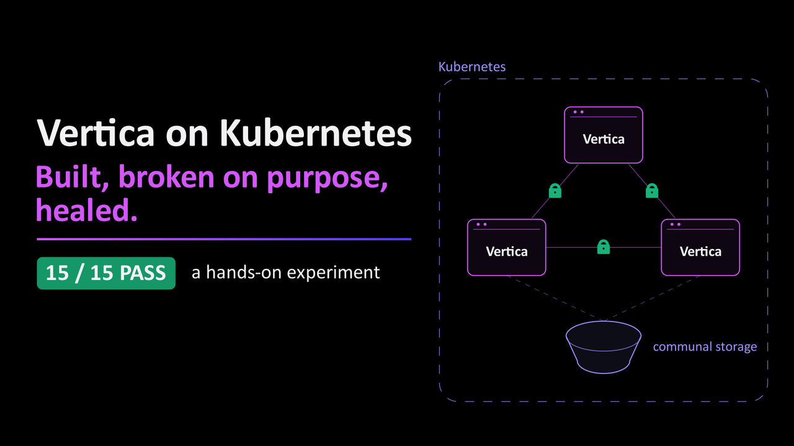
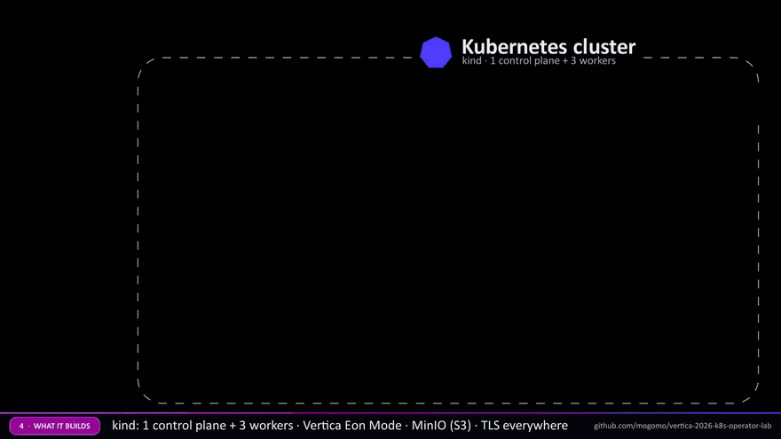
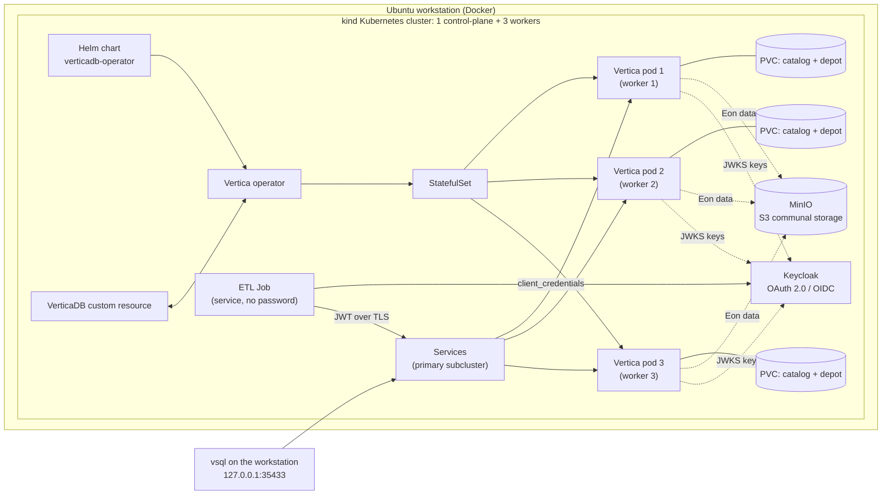

# Vertica on Kubernetes: a hands-on operator lab

**One script builds a production-style Vertica cluster on Kubernetes on a single Ubuntu
workstation, then tries to break it: 15 automated tests, including machine-to-machine
logins with OAuth 2.0 / JWT. The run published here passed 15 of 15.**

```
sudo ./vertica-k8s-lab.sh --install     # about 5 minutes
sudo ./vertica-k8s-lab.sh --test        # 15 tests, about 10 minutes
```

> This is a demo, provided "as is", without warranties of any kind. It ran in a
> single-workstation sandbox; the results are not a production benchmark,
> certification or sizing guidance. For production, also test the items in
> [docs/production-checklist.md](docs/production-checklist.md), using the Vertica
> documentation for your version.

### The video (5 minutes)

[](https://youtu.be/YOUR_VIDEO_ID)

What the script builds, the install, the 15 tests, the failures on purpose and the
result, with footage of a real run. English narration; English and Hebrew subtitles.

---

## Contents

1. [Why this lab exists](#1-why-this-lab-exists)
2. [Kubernetes, operators and JWT in two minutes](#2-kubernetes-operators-and-jwt-in-two-minutes)
3. [What the script builds](#3-what-the-script-builds)
4. [Running it](#4-running-it)
5. [The 15 tests](#5-the-15-tests)
6. [Measured results](#6-measured-results)
7. [Machine-to-machine logins with JWT](#7-machine-to-machine-logins-with-jwt)
8. [Practical tips](#8-practical-tips)
9. [For production, also test](#9-for-production-also-test)
10. [Repository layout](#10-repository-layout)
11. [Disclaimer and license](#11-disclaimer-and-license)

---

## 1. Why this lab exists

Most of my work with Vertica is about what it does best: powerful analytics at scale.
This time I wanted to explore a different side of Vertica: running on Kubernetes, where
the Vertica operator automates deployment, recovery, security and scaling.

So I built a test lab on one Ubuntu workstation, with one goal: put the operator through
its paces, including breaking things on purpose. Three rules:

1. **Automate everything in one script:** install, demo, test and clean up.
2. **Use only official building blocks:** the operator's Helm chart from
   `vertica.github.io/charts` and the official `opentext/vertica-k8s` server image.
3. **Don't just run it. Break it on purpose, and measure what happens.**

This repository is the result: the script, the full logs of one validation run, and
what I learned along the way.

## 2. Kubernetes, operators and JWT in two minutes

- **Kubernetes** runs applications in containers across many servers and keeps them in
  the state you describe. You declare "three database pods"; Kubernetes makes it so, and
  keeps it so.
- **An operator** adds expert knowledge to Kubernetes. The Vertica operator understands a
  custom resource called `VerticaDB` and knows how to create, heal, scale, upgrade and
  revive a Vertica database: tasks a DBA would otherwise do by hand.
- **Eon Mode** separates compute from storage. The authoritative copy of the data lives
  in S3-compatible *communal storage*; each node keeps a local *depot* cache. Pods can
  come and go; the data stays.
- **A JWT** (JSON Web Token) is a signed, short-lived digital pass. A service gets one
  from an identity provider and presents it to the database instead of a password.
  Vertica checks the signature, issuer, audience and expiry itself.

## 3. What the script builds

Everything runs inside Docker on one Ubuntu workstation, using
[kind](https://kind.sigs.k8s.io/) ("Kubernetes in Docker").





More detail: [docs/architecture.md](docs/architecture.md).

| Layer | What the lab uses |
|---|---|
| Kubernetes | kind v0.30.0, Kubernetes v1.34.0; 1 control-plane and 3 workers |
| Operator | Helm chart `vertica-charts/verticadb-operator` 26.2.2 |
| Vertica | Server 26.2.0-4 (`opentext/vertica-k8s:26.2.0-4-minimal`), Eon Mode, database `labdb`, 3-node primary subcluster, K-safety 1, one primary pod per worker |
| Communal storage | MinIO (S3-compatible), bucket `vertica-lab` |
| TLS | Operator-managed TLS on three layers: client-server, HTTPS/node management agent, and **between the nodes** (VERIFY_CA, Spread encrypted). Plain-text remote logins are rejected. |
| Identity | Keycloak 26.7.5, realm `vertica-lab`, service clients that log in with `client_credentials` |
| Vertica login for services | Authentication record `vlab_oauth_jwt`: method `oauth`, `validate_type='JWT'`, keys from the identity provider's JWKS URL, issuer + audience + scope enforced, TLS only |
| Monitoring | metrics-server, the operator's `/metrics` endpoint (HTTPS, token protected), the Vertica server's Prometheus endpoint, `v_monitor` system tables |

**Versions.** The script targets the newest operator and server release. When I ran it,
the newest *published* container images and chart were server 26.2.0-4 and operator
26.2.2, so `--install` used those automatically (`VERSION_FALLBACK=true`, shown in the
install log). Set `VERTICA_TARGET_VERSION` or `VERTICA_IMAGE` to pin a version.

**What the script never touches.** If the workstation already has a Vertica installation
(mine has one), the lab leaves it alone: it only *reads* its version, processes, ports and
configuration time stamp, and the last test proves they are unchanged. The lab's own
ports bind to `127.0.0.1` only, kernel settings are changed at runtime only, and nothing
is enabled at boot.

## 4. Running it

**Prerequisites**

- Ubuntu on x86_64 (validated on Ubuntu 26.04.1 LTS), bash 4.4 or newer, sudo rights
- At least 24 GB of *available* RAM (64 GB recommended), 4 or more CPU cores, 60 GB free disk
- Internet access to GitHub, `dl.k8s.io`, `get.helm.sh`, `vertica.github.io`, Docker Hub,
  `quay.io` and `registry.k8s.io`
- Optional: a Vertica license file. Without one, the image's built-in Community Edition
  limits apply (3 nodes, 1 TB), and the scaling test uses a small separate database.

The script installs what it needs (Docker, kind, kubectl, Helm) and tracks it, so
`--cleanup` removes only what the script itself added.

**Install and run**

```bash
sudo mkdir -p /opt/vertica-k8s-lab
sudo install -m 0750 vertica-k8s-lab.sh /opt/vertica-k8s-lab/
# optional: your license file
sudo install -m 0600 vertica_license.dat /opt/vertica-k8s-lab/vertica_license.dat

cd /opt/vertica-k8s-lab
sudo ./vertica-k8s-lab.sh --install          # build the lab (about 5 min on a fast connection)
sudo ./vertica-k8s-lab.sh --demo             # create a table, load, query in every pod, JWT login
sudo ./vertica-k8s-lab.sh --test             # 15 tests (about 10 min)
sudo ./vertica-k8s-lab.sh --status           # read-only dashboard
sudo ./vertica-k8s-lab.sh --info --watch 5   # live view: CRs, pods, Vertica nodes, events
sudo ./vertica-k8s-lab.sh --cleanup          # remove everything the lab created (asks first)
sudo reboot
sudo ./vertica-k8s-lab.sh --verify-clean     # prove nothing came back after the reboot
```

Run it as your normal administrator account through `sudo`, not as `dbadmin` and not as
root. To record a run: `sudo script -q -c "./vertica-k8s-lab.sh --test" test-console.log`.

**Useful options**

| Option | Purpose |
|---|---|
| `--only m2m,security` / `--skip scaling` | Run or skip test groups: `health workload perf storage monitoring security m2m isolation reconcile selfheal nodefail backup scaling final` |
| `--yes` | No confirmation prompt |
| `--license FILE` | Use a license file from another path |
| `--keep-logs` | Keep logs and reports on `--cleanup` |
| `--no-color` | Plain output |

**Environment settings** (set them on `--install` or `--test`):

| Variable | Default | Meaning |
|---|---|---|
| `VERTICA_TARGET_VERSION` | `26.3` | Server and operator version to install; falls back to the newest published release if it has no images yet (`VERSION_FALLBACK=true`) |
| `VERTICA_IMAGE_FLAVOR` | `minimal` | `minimal` or `full` server image |
| `VDB_MEMORY_GB` / `VDB_CPU` | auto | Size of each Vertica pod (requests = limits) |
| `ENABLE_DB_TLS` | `true` | Operator-managed client-server and HTTPS TLS |
| `ENABLE_INTERNODE_TLS` | `true` | TLS between the Vertica nodes |
| `ENABLE_OAUTH` | `true` | Keycloak and the OAuth 2.0 / JWT login |
| `LOAD_SECONDS` | `60` | Client load during the failure tests |
| `NODE_FAIL_SECONDS` | `60` | How long a worker stays frozen in T12 |
| `RECOVERY_TIMEOUT` / `SCALE_TIMEOUT` | `300` / `600` | Time caps for every recovery and scaling wait |

## 5. The 15 tests

Every test opens with a card that says what it does and what to expect, and ends with a
STATUS line. `REAL` tests exercise real behaviour; `SIM` tests simulate a failure that a
single workstation can only imitate (for example, a frozen container instead of a dead
server).

| # | Test | Scope | What it proves |
|---|---|---|---|
| T01 | Cluster health check | REAL | 4/4 Kubernetes nodes, operator, admission webhook, MinIO, Keycloak, 3/3 pods and Vertica nodes UP, K-safe, communal storage registered |
| T02 | SQL workload: star schema | REAL | 5 million rows loaded, segmentation skew 1.00, referential integrity |
| T03 | Query performance, concurrency and bulk load | REAL | 6 analytic queries, depot cold vs warm, 8 concurrent sessions, COPY |
| T04 | Persistent storage | REAL | One persistent volume per pod (catalog + depot); the data is in communal storage |
| T05 | Monitoring and metrics | REAL | metrics-server, the operator `/metrics` endpoint protected by bearer tokens (JWT), the Vertica Prometheus endpoint, `v_monitor`, Kubernetes events |
| T06 | Security controls | REAL | Secrets, non-root, Kubernetes and database RBAC, TLS on all three layers, plain-text logins rejected, NetworkPolicy |
| T07 | Machine-to-machine login (OAuth 2.0 / JWT) | REAL | 15 checks: token login, least privilege, identity from the token, forged / tampered / wrong-audience / expired tokens rejected, no password path, audit, key rotation |
| T08 | Workload isolation | REAL | Resource pools for ETL and BI |
| T09 | Operator auto-repair | REAL | Deleted Service and StatefulSet drift repaired; the database keeps running while the operator is down; the webhook blocks unsafe changes |
| T10 | Self-healing: Vertica process crash | SIM | The database stays up with K-safety; the operator restarts the node |
| T11 | Self-healing: pod deleted | SIM | The pod is recreated, its volume re-attached, no data lost |
| T12 | Node failure: a worker freezes for 60 s | SIM | Reads and writes continue with 1 of 3 nodes lost; full recovery without manual steps |
| T13 | Backup, restore and disaster recovery | REAL | Restore point, object-level restore, the whole deployment deleted and **revived from S3** |
| T14 | Elastic scaling | SIM | A compute subcluster is added, scaled out and in, and removed, while the primary keeps serving |
| T15 | Final health and host-safety check | REAL | Everything healthy, no test objects left, host Vertica untouched |

The full list of checks is in [docs/test-catalog.md](docs/test-catalog.md).

## 6. Measured results

**Validation run:** clean workstation, `--cleanup`, `--verify-clean`, `--install`,
`--test`, `--demo`. **15 PASS, 0 FAIL, 0 WARN** in 10 minutes 7 seconds. Install took
5 minutes 17 seconds. All logs: [logs/](logs/README.md).

Hardware: one Ubuntu 26.04.1 workstation, 22 CPU threads, 64 GB RAM, NVMe SSD. All
Kubernetes nodes, all three Vertica pods, MinIO and Keycloak share it. Each Vertica pod
had 3 CPUs and 7 GiB of RAM. **The numbers show behaviour, not capacity.**

**Workload (T02, T03)**

| Metric | Result |
|---|---|
| Load: INSERT..SELECT of 5 M rows (with a join) | **2.66 M rows/s**, segmentation skew 1.00 |
| COPY FROM LOCAL, 500 K rows | 1.52 M rows/s |
| Point lookup (median) | **6 ms** |
| Window function, 7-day moving average | 30 ms |
| Top-10 customers with RANK() | 65 ms |
| Star join + GROUP BY | 102 ms |
| Distinct customers per category | 141 ms |
| 90th percentile per channel | 824 ms |
| Depot: cold (from S3) vs warm | 115 ms vs 102 ms |
| 8 concurrent sessions | 17.8 queries/s, **0 errors** |

**Machine-to-machine (T07)**

| Metric | Result |
|---|---|
| Token request (client_credentials) | 112 ms |
| Database login with JWT validation | 132 ms |
| Forged, tampered, wrong-audience and expired tokens | all rejected |
| Signing-key rotation | new key accepted with no change in Vertica |

**Self-repair and failures (T09 to T12)**

| Event | Result |
|---|---|
| Service deleted | recreated by the operator in **3 s** |
| StatefulSet changed by hand | corrected to the CR's desired state in **3 s** |
| Vertica process killed | database stayed UP (K-safety); node back UP 49 s after the crash, without help |
| Pod deleted | node rejoined **27 s** after the deletion; same volume; 5,000,000 rows intact |
| Worker frozen for 60 s | reads and writes kept working; detected in 47 s; **3/3 UP 15 s** after the worker returned |

**Disaster recovery and elasticity (T13, T14)**

| Event | Result |
|---|---|
| Save a restore point | 5 s |
| Restore a dropped table | 5 s |
| Deployment deleted (pods and volumes), revived from S3 | **62 s** to 3/3 UP (78 s from shutdown) |
| Add a compute subcluster online | 27 s |
| Scale it out 1 → 2 / in 2 → 1 | 33 s / 23 s |
| Remove the subcluster | 24 s |

**Client view during failures.** A small client in the cluster ran one query per second
through the primary Service during T10 to T12 (a new connection for each query, no
retries), so every second without an answer counts:

| Failure | Longest gap without an answer | Answered seconds in the window |
|---|---|---|
| Pod deleted (graceful stop) | 9 s | 85 % |
| Worker frozen (abrupt) | 45 s | 54 % |
| Process killed (abrupt) | 46 s | 23 % |

When a pod is deleted, Kubernetes stops it in an orderly way, so the gap is short. After
an abrupt failure, Vertica first has to decide that the node is gone; on this workstation
that took about 45 s, after which the remaining nodes carried on and the database never
went down. Real applications should use connection timeouts, retries and connection load
balancing, so they wait through such a gap instead of failing.

Raw data: [logs/report/perf.csv](logs/report/perf.csv) and
[logs/report/results.csv](logs/report/results.csv).

## 7. Machine-to-machine logins with JWT

Applications, ETL jobs and other services should not hold database passwords. In this
lab the ETL service has **no password at all**:

1. The ETL job asks Keycloak for a token with its client id and secret
   (`grant_type=client_credentials`). No human user is involved.
2. Keycloak returns a signed JWT with the audience `vertica`, the scope `vertica`, the
   issuer, and a short lifetime.
3. The job logs in to Vertica over TLS with `vsql -M oauth -U svc_etl`.
4. Vertica validates the token itself: signature (keys from the JWKS URL), issuer,
   audience, scope and expiry. It maps the token's `azp` claim (the client id) to the
   database user `svc_etl`.

The Vertica side is one authentication record:

```sql
CREATE AUTHENTICATION vlab_oauth_jwt METHOD 'oauth' HOST TLS '0.0.0.0/0';
ALTER AUTHENTICATION vlab_oauth_jwt SET
  validate_type             = 'JWT',
  jwt_issuer                = 'http://keycloak.vertica-lab-idp.svc.cluster.local:8080/realms/vertica-lab',
  jwt_jwks_url              = 'http://keycloak.vertica-lab-idp.svc.cluster.local:8080/realms/vertica-lab/protocol/openid-connect/certs',
  jwt_user_mapping          = 'azp',
  jwt_accepted_audience_list = 'vertica',
  jwt_accepted_scope_list   = 'vertica';
CREATE USER svc_etl;                                  -- no password
GRANT AUTHENTICATION vlab_oauth_jwt TO svc_etl;
```

What T07 proved, in the real run:

- `svc_etl` logs in with the token: session user `svc_etl`, method `OAuth`, TLS `Server`.
- Least privilege: it can read what it was granted, but cannot INSERT or DROP.
- **The identity comes from the token.** Asking for `-U dbadmin` with `svc_etl`'s token
  still opens an `svc_etl` session.
- A token with a tampered signature, or a forged payload (`azp=dbadmin`), is rejected.
- A valid token without the `vertica` audience is rejected.
- A 15-second token works, then is rejected once expired.
- A password login as `svc_etl` is impossible.
- Logins and rejected tokens appear in `v_monitor.user_sessions` and
  `v_monitor.login_failures`.
- After the identity provider rotates its signing key, a token signed with the new key
  is accepted **without any change in Vertica**, because Vertica reads the keys from JWKS.

The demo (`--demo`, step 8) runs the same flow as a Kubernetes Job whose only credential
is the OAuth client secret:

```
 db_user | auth  |  tls   |  country  | readings | avg_c
---------+-------+--------+-----------+----------+-------
 svc_etl | OAuth | Server | Israel    |        4 |  22.9
 svc_etl | OAuth | Server | Australia |        1 |  21.7
 ...
```

T05 shows the same idea on the Kubernetes side: the operator's `/metrics` endpoint
accepts only bearer tokens (Kubernetes service-account JWTs) and rejects anonymous,
tampered and wrong-audience tokens.

Full walkthrough: [docs/m2m-authentication.md](docs/m2m-authentication.md).

## 8. Practical tips

Things that made the lab work smoothly. All of them are good practice in any Vertica on
Kubernetes deployment.

**Authentication and TLS**

- **Keep tokens lean: one audience per token.** Give the database its own client scope
  (here `vertica`) and remove the identity provider's default scopes from service
  clients. The token then carries exactly one audience (`"aud": "vertica"`) and only the
  claims a service needs.
- **Name the database user on every OAuth login** (`vsql -M oauth -U svc_etl`, or the
  user property in your driver). The session identity still comes from the signed token,
  as T07 shows; naming the user simply makes the request explicit.
- **With the `vertica.com/enable-fallthrough: "true"` annotation, add your own REJECT
  records for plain text.** In this mode the operator creates only the TLS records (this
  is documented as the automatic TLS fallthrough migration). The lab adds
  `METHOD 'reject' HOST NO TLS` records for `0.0.0.0/0` and `::/0` at priority 10. They
  match only non-TLS connections, so they never hide the operator's own certificate
  login.
- **Never add a higher-priority password record for PUBLIC.** It would sit above the
  operator's TLS-certificate record, and the operator's HTTPS calls (used to restart
  nodes) would then fail. Grant password or OAuth records to specific users or roles.
- **To revive a TLS-enabled database,** add the annotation `vertica.com/enable-tls-auth: "true"`
  to the reviving CR, as the documentation describes, and pass the TLS secrets back.

**Images and packages**

- The `-minimal` server image is small and fast to pull. It does not include
  ApproximateLib (`APPROXIMATE_COUNT_DISTINCT`) or ParquetExport (`EXPORT TO PARQUET`).
  Use the full image (`VERTICA_IMAGE_FLAVOR=full`) if you need them; the lab uses
  `COUNT(DISTINCT)` and skips the Parquet export with the minimal image.

**Scheduling and storage**

- Make **required** pod anti-affinity select only the primary pods
  (`vertica.com/subcluster-selector-name: <vdb>-primary`). Then each primary lands on its
  own worker (real K-safety across hosts), and secondary subclusters can still schedule.
- The operator **keeps PVCs after a scale-in**, on purpose, so a later scale-out is fast.
  Delete them when you no longer need them.
- Size each Vertica pod with requests equal to limits (Guaranteed QoS), as the lab does.

**Testing on kind**

- Vertica runs as PID 1 in its container, so a signal sent from inside the pod is
  ignored. To simulate a crash, kill the process from the kind node's PID namespace
  (`docker exec <kind-node> kill -9 <pid>`), which looks to Kubernetes exactly like an
  out-of-memory kill.
- To simulate a dead server, pause the kind worker container (`docker pause`).
- With Docker 29, load multi-platform images into kind as a single-platform archive:
  `docker save --platform linux/amd64 -o image.tar <image>`, then
  `kind load image-archive image.tar`.

## 9. For production, also test

A single workstation cannot show everything. Before production, also test these
capabilities, all described in the Vertica 26.3 documentation for Vertica on Kubernetes:

| | Area | What to test |
|---|---|---|
| a | Supported platform | A supported managed Kubernetes service (Amazon EKS, Google GKE, Azure AKS) or Red Hat OpenShift, with a highly available control plane |
| b | Multi-AZ deployment | Subclusters in different availability zones with affinity / anti-affinity; test the loss of a zone |
| c | Durable communal storage | AWS S3, Google Cloud Storage, Azure Blob Storage, HDFS, or a production S3-compatible store |
| d | Volume expansion | A `local.storageClass` that allows expansion; verify that the operator grows the depot/catalog volume |
| e | Online upgrade | `upgradePolicy: Online` (server 24.3.0-2 and higher) or `ReadOnlyOnline`; needs more than one subcluster |
| f | Autoscaling | `VerticaAutoscaler` with a HorizontalPodAutoscaler or a KEDA ScaledObject, driven by Prometheus metrics |
| g | Replication | `VerticaReplicator`: replicate to another database or to a sandbox |
| h | Sandboxes | Subcluster sandboxes (`spec.sandboxes`) for isolated testing and upgrade rehearsals |
| i | Restore points | `VerticaRestorePointsQuery`: save, list and restore; manage archives |
| j | Enterprise secret stores | CR secrets in AWS Secrets Manager or Google Secret Manager |
| k | Monitoring | Prometheus and Grafana (operator `/metrics` and Helm chart options) |
| l | External access | LoadBalancer services with real DNS names |
| m | Diagnostics | `VerticaScrutinize`: collect a diagnostics bundle the way Vertica Support asks for it |
| n | Production performance | Your real workload on production-sized nodes |
| o | Workload identity (IRSA) | On Amazon EKS, Vertica pods reach S3 with their service-account JWT instead of static keys |
| p | Corporate identity provider | OAuth 2.0 / JWT with Okta, OTDS or Keycloak in production mode: HTTPS, high availability, just-in-time user provisioning, role mapping |

Details, and the 13 capabilities the test report marks as "needs a real cluster":
[docs/production-checklist.md](docs/production-checklist.md).

## 10. Repository layout

```
vertica-k8s-lab.sh            the lab: install, demo, test, status, info, cleanup, verify-clean
docs/
  architecture.md             components, namespaces, ports, TLS layers, data flow
  test-catalog.md             every test and every check, with the real run's result
  m2m-authentication.md       OAuth 2.0 / JWT machine-to-machine login, step by step
  production-checklist.md     what to test beyond a single workstation
logs/                         the validation run (sanitized), see logs/README.md
  console/                    what the terminal showed, for each command
  run/                        the script's detailed run logs (every command and output)
  report/                     summary.txt, results.csv, perf.csv, client load samples
media/                        the video's thumbnail and an animated excerpt
```

## 11. Disclaimer and license

This is a demo test, provided "as is", without warranties of any kind. It ran in a
single-workstation sandbox; the results are not a production benchmark, certification
or sizing guidance. For production, also test the items in section 9, using the Vertica
documentation for your version.

This project is not affiliated with or endorsed by OpenText. Vertica is a trademark of
its owner; all other trademarks belong to their respective owners.

The script is released under the [MIT License](LICENSE).
