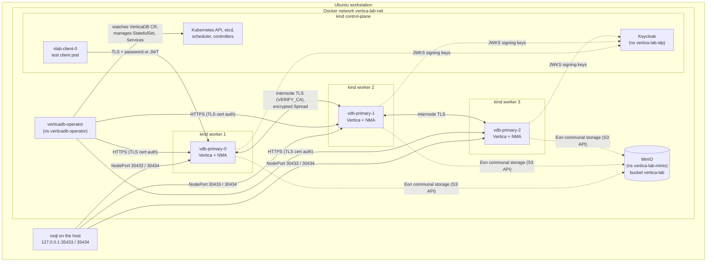

# Architecture

Everything the lab creates runs in Docker on one Ubuntu workstation. The diagram shows the
running lab after `--install`.

## Components

| Component | Namespace | Details |
|---|---|---|
| kind cluster `vertica-lab` | - | kind v0.30.0, node image Kubernetes v1.34.0; 1 control-plane, 3 workers; every node is a Docker container with restart policy `no` |
| metrics-server | `kube-system` | v0.7.2, live CPU/RAM metrics |
| VerticaDB operator | `verticadb-operator` | Official Helm chart `vertica-charts/verticadb-operator` (26.2.2 in the published run), admission webhook, `/metrics` over HTTPS with token authentication |
| VerticaDB `vdb` | `vertica-lab` | Database `labdb`, Eon Mode, primary subcluster of 3 pods, K-safety 1, shard count 6, one pod per worker (required anti-affinity on primary pods only) |
| MinIO | `vertica-lab-minio` | S3-compatible communal storage, bucket `vertica-lab`. The script picks the first pullable MinIO image; in the published run that was `cgr.dev/chainguard/minio` |
| Keycloak | `vertica-lab-idp` | 26.7.5 in development mode (in-memory database, HTTP inside the cluster), realm `vertica-lab`, clients `svc_etl`, `svc_other`, `svc_short` |
| Test client | `vertica-lab` | `vlab-client-0`, runs vsql and curl inside the cluster |

Namespaces carry Pod Security Admission labels: `baseline` (warn and audit) for the
database namespace, `restricted` (warn) for MinIO and the identity provider. The Vertica server container runs as
uid 5000 (non-root).

## Sizing

`--install` sizes the Vertica pods from the available RAM and CPU, with requests equal to
limits (Guaranteed QoS). In the published run each pod had **7 GiB RAM and 3 CPUs**.
Override with `VDB_MEMORY_GB` and `VDB_CPU`. `HOST_RESERVE_GB` (default 8) keeps memory
free for the host.

## Storage

- **Local:** each Vertica pod has one PersistentVolumeClaim (`local.requestSize: 20Gi`,
  storage class `standard`, kind's local-path provisioner) for the catalog and the depot.
- **Communal:** `s3://vertica-lab/<db-path>` in MinIO, accessed with a credential Secret
  (`communal-creds`). In Eon Mode this is the authoritative copy of the data; T13 deletes
  every pod and volume and revives the database from it.

## TLS and authentication

| Layer | Setting in the VerticaDB CR | Mode reported by the operator |
|---|---|---|
| Client to server | `clientServerTLS.enabled: true` | `try_verify` |
| HTTPS / node management agent | `httpsNMATLS.enabled: true` | `try_verify` |
| Between the nodes | `interNodeTLS.enabled: true`, `mode: VERIFY_CA` | `verify_ca` (data channel certificate from a Kubernetes Secret, Spread encrypted) |

Authentication records in the database:

| Record | Created by | Purpose |
|---|---|---|
| `k8s_*_tls_builtin_auth` | operator | TLS certificate login (used by the operator), with FALLTHROUGH so a TLS login without a client certificate can continue to password authentication |
| `vlab_reject_plain_ipv4` / `_ipv6` | lab | `METHOD 'reject' HOST NO TLS`, priority 10, PUBLIC: plain-text remote logins are refused |
| `vlab_oauth_jwt` | lab | `METHOD 'oauth' HOST TLS`, JWT validation, granted only to `svc_*` users |

The CR carries the annotation `vertica.com/enable-fallthrough: "true"`. See
[m2m-authentication.md](m2m-authentication.md) for the OAuth record.

## Access from the host

| Host port (127.0.0.1 only) | NodePort | Target |
|---|---|---|
| 35433 | 30433 | primary subcluster |
| 35434 | 30434 | secondary subcluster (scaling test) |

The host's own Vertica ports (5433 and others) are never used by the lab.

## Files on the host

Everything lives under `/opt/vertica-k8s-lab/` (root-owned):

| Path | Content |
|---|---|
| `vertica-k8s-lab.sh` | the script |
| `vertica_license.dat` | optional license file (mode 0600) |
| `bin/` | kind, kubectl, helm (checksum-verified, not on the system PATH) |
| `state/` | `lab.state`, `secrets.env` (generated passwords, mode 0600), `kubeconfig` |
| `manifests/` | every YAML the script applied |
| `logs/`, `reports/` | run logs and test reports |

`--cleanup` removes all of it (logs and reports are kept with `--keep-logs`), the kind
cluster, images pulled by the lab, runtime kernel settings and Docker if the script
installed it. `--verify-clean` audits that nothing is left or starts at boot.
